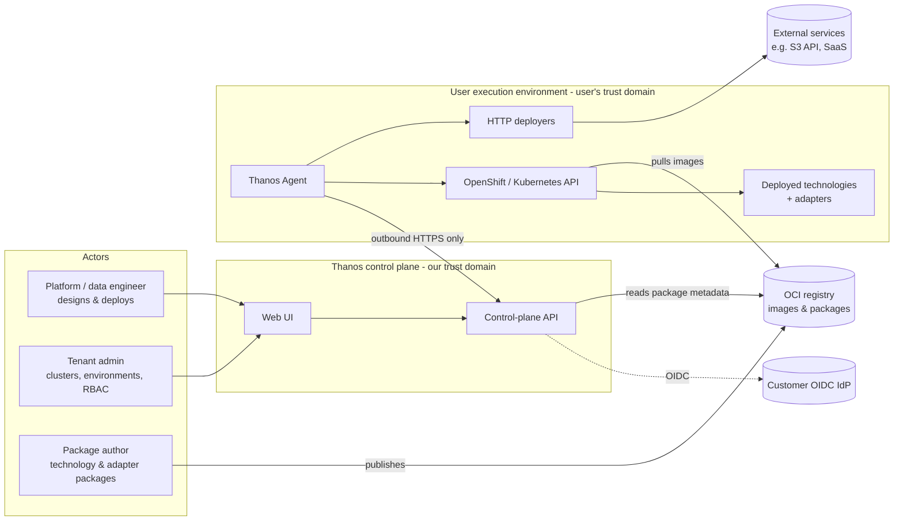
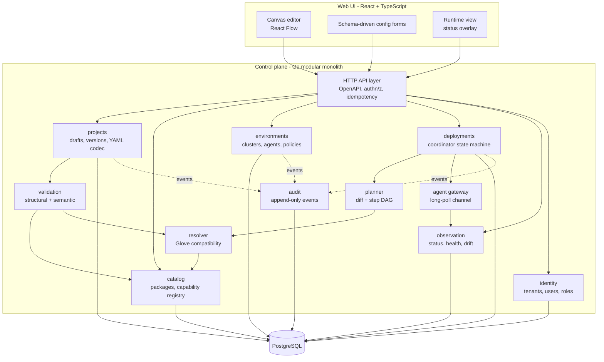
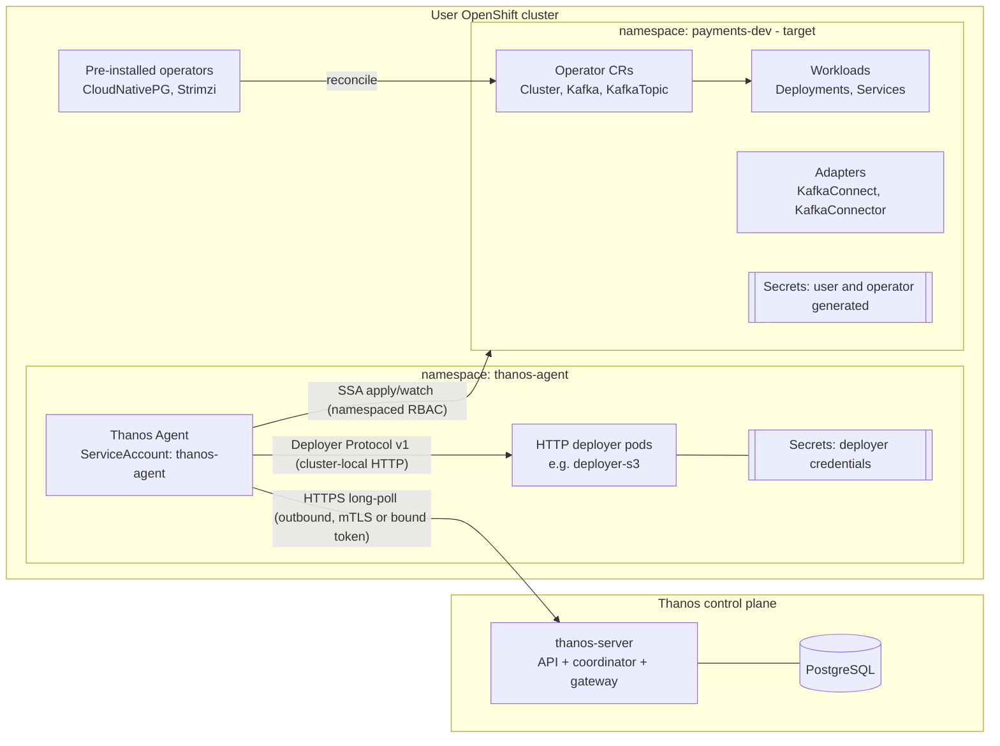
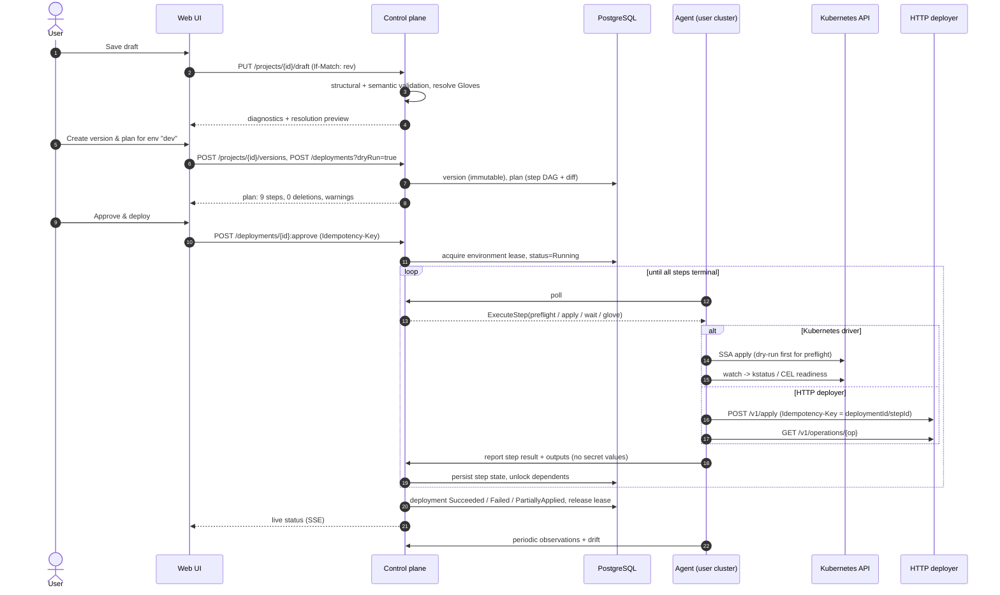
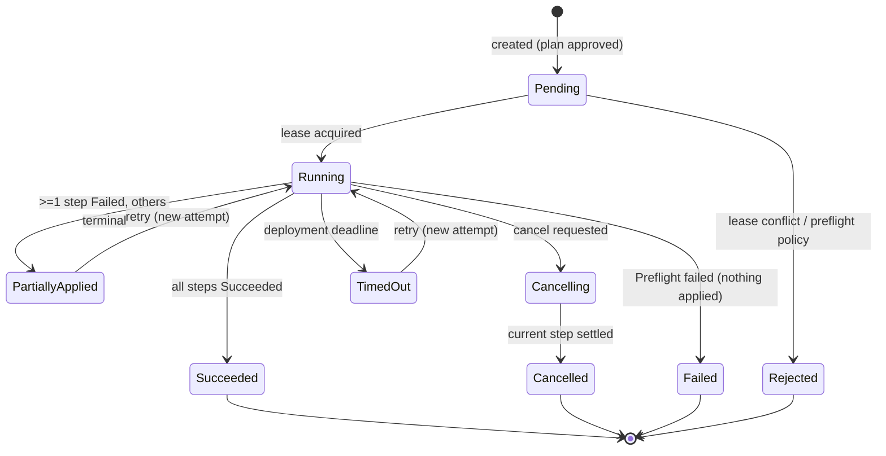
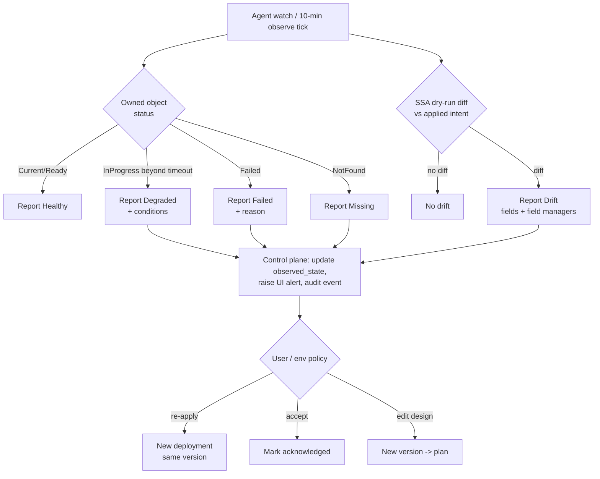

# 03 — System Architecture

> Status: **Recommended architecture, pre-implementation.** Items marked *(assumption)* or *(PoC)* must be confirmed by the experiments in [11-testing-and-validation-strategy.md](11-testing-and-validation-strategy.md#1-proof-of-concept-experiments).
> Related: [05 Gloves](05-glove-interoperability-model.md) · [06 Deployer contract](06-deployer-plugin-contract.md) · [09 Security](09-security-and-trust-boundaries.md) · [10 ADRs](10-architecture-decision-records.md)

## 1. The system in plain language

Thanos has two halves:

1. **The control plane** (ours). It holds projects, the technology catalog and the capability registry. It validates designs, computes deployment plans and records what happened. It never touches user data and never stores user secret values.
2. **The execution environment** (the user's). This is the user's OpenShift/Kubernetes cluster, where technologies, adapters and a small **Thanos Agent** run. The agent connects *outbound* to the control plane, receives plan steps, executes them with cluster-local credentials, and reports status.

The user draws a graph. The graph is serialized as a versioned YAML **Project** document. The control plane resolves every Glove into a concrete binding. It then builds a **Plan**: an ordered DAG of idempotent steps. The agent executes the plan in the user's cluster. After deployment, the agent keeps watching what it deployed and reports health and drift.

## 2. Architectural style

| Option | Fit for a 3-person team | Verdict |
|---|---|---|
| **Microservices / service-oriented** (catalog, projects, planner, deployments as separate services) | Every module boundary becomes a network boundary, with distributed transactions, N pipelines and N on-call surfaces. The domain is still being discovered, so boundaries will move. | Rejected for MVP |
| **Modular monolith** (one deployable, strict internal module boundaries) | One build, one DB, in-process calls, transactional consistency between project versions and deployments. Boundaries are enforced by package rules, not network hops. | **Chosen for the control plane** |
| **Selectively distributed** (separate processes only where a trust or placement boundary forces it) | The agent *must* run in the user cluster. Third-party deployers *must not* run in our process. | **Chosen at the trust boundaries** |

**Decision ([ADR-001](10-architecture-decision-records.md#adr-001-architecture-style)):** one modular-monolith control plane plus exactly two kinds of out-of-process components, both forced by trust and placement:

- **Thanos Agent:** one per registered cluster, running in the user's cluster.
- **HTTP Deployers:** one per external-service technology type, run *by the agent* in the user's cluster.

Nothing else is a separate service in the MVP.

### Keeping the monolith modular

- Each module is a Go package under `internal/<module>` and exposes a small Go interface. Other modules import only that interface (enforced in CI with an import-boundary linter such as `depguard`).
- Each module owns its tables. No cross-module SQL joins in application code; reporting views are the only exception.
- Cross-module side effects go through an in-process event bus backed by a transactional outbox table, so a later extraction does not change semantics.
- **Candidates for later extraction**, only when measured load demands it:
  1. Agent gateway (many long-lived agent connections).
  2. Status ingest (high write volume).
  3. Plan executor workers.

## 3. System context

**Decision this diagram explains:** every arrow that crosses into the user's domain originates *inside* the user's domain (the agent dials out). The control plane holds no kubeconfig and no inbound route to any cluster.

## 4. Logical architecture and backend modules

| Module | Responsibility | Owns | Must not |
|---|---|---|---|
| `identity` | Tenants, users (from OIDC), memberships, role bindings, authorization decisions | `tenants`, `users`, `memberships`, `role_bindings` | Store passwords (OIDC only) |
| `projects` | Draft editing with optimistic concurrency, immutable versions, YAML↔model codec, canonical serialization, schema migration | `projects`, `project_drafts`, `project_versions` | Know about clusters |
| `catalog` | Package ingestion and verification, version index, capability vocabulary, adapter index | `catalogs`, `packages`, `package_versions`, `vocabulary` | Execute package code (packages are data) |
| `validation` | Structural (JSON Schema) and semantic validation, diagnostics with JSON Pointers | — (pure) | Call clusters |
| `resolver` | Glove compatibility, adapter search, ranking, explanations, lock output | — (pure, deterministic) | Depend on time or randomness |
| `planner` | Desired-vs-last-applied diff, step DAG, ordering, deletion plans | — (pure) | Perform I/O |
| `deployments` | Deployment records, step state machine, environment lease, retries, cancel, recovery | `deployments`, `deployment_steps` | Talk to K8s directly |
| `environments` | Clusters, agent registration, environment policies (egress allow-list, approval rules) | `clusters`, `agents`, `environments` | Hold cluster credentials |
| `observation` | Ingest agent reports, current health per instance and Glove, drift records | `observed_state`, `drift_reports` | Store logs long-term |
| `audit` | Append-only security and change events | `audit_events` | Allow update/delete |
| `agent gateway` | Authenticated agent channel, message routing, backpressure | — | Contain business logic |

`validation`, `resolver` and `planner` are **pure functions** over (project version, catalog snapshot, environment facts). This is the most important testability decision. They can be exhaustively unit- and property-tested without clusters, and coding agents can work on them in isolation.

## 5. Control plane vs. user execution environment

**What crosses the boundary (agent → control plane):** step results, conditions, readiness, sanitized error messages, resource identities (kind/name/namespace), Secret *names*, metrics summaries, and, only when a user explicitly opens a log viewer, a transient log stream that is not persisted.

**What never crosses:** secret values, application data, message payloads, full manifests of resources Thanos does not own.

Full model: [09-security-and-trust-boundaries.md](09-security-and-trust-boundaries.md).

### Agent responsibilities

| Component | Function |
|---|---|
| Channel client | Long-polls `POST /agent/v1/poll`, acknowledges messages, sends reports. Reconnects with jittered backoff. Proxy-aware (`HTTPS_PROXY`). |
| Step executor | Executes one plan step at a time per instance (parallel across independent instances). Every step is idempotent and keyed by `(deploymentId, stepId)`. |
| Kubernetes driver | Renders package templates (CEL `${…}` expressions), applies with **Server-Side Apply** (field manager `thanos-agent`), and labels every owned object with `thanos.example/project`, `thanos.example/instance` and `thanos.example/deployment` *(placeholder prefix: `thanos.io` belongs to the CNCF Thanos project; final prefix follows the product rename)*. |
| Readiness evaluator | Uses `kstatus` for standard resources and package-declared CEL rules for CRDs. Reports `InProgress / Current / Failed / Unknown`. |
| HTTP deployer driver | Ensures the deployer Deployment is running, calls Deployer Protocol v1, polls long operations. |
| Watcher / drift checker | Watches owned objects by label. Every 10 min (configurable) runs an SSA dry-run against last-applied intent and reports drift. |
| Log streamer | On request, streams pod logs for an owned workload through the channel (rate- and size-limited). |

The agent does **not** run arbitrary user code, does not build images, and does not install operators in the MVP.

## 6. Agent channel protocol (summary)

- **Transport:** HTTPS/1.1 or HTTP/2 to `https://<control-plane>/agent/v1/*`. It works through corporate HTTP proxies and needs no inbound port.
- **Long-poll:** `POST /agent/v1/poll {agentId, lastAckedSeq, capacity}` returns `200 {messages:[…]}` or `204` after ≤ 30 s. Messages: `ExecuteStep`, `CancelStep`, `Observe`, `StreamLogs`, `UpgradeAgent`.
- **Reports:** `POST /agent/v1/reports {stepResults[], observations[], drift[]}`. Each report is idempotent, keyed by `(agentId, seq)`.
- **Auth:** a one-time join token (TTL 1 h) is exchanged at registration for a short-lived, rotating agent credential (MVP: signed JWT bound to agentId with 1 h TTL plus refresh. Upgrade path: mTLS client certificates).
- **Why not gRPC streams for MVP:** long-poll JSON is the most proxy-tolerant, debuggable option and is plenty at MVP scale (≤ 50 agents). Revisit when agent count or latency requirements grow.

## 7. Desired state, observed state, reconciliation

| Concept | Where it lives | Who changes it |
|---|---|---|
| **Desired state** | Immutable `ProjectVersion` (YAML) + environment overrides | User (via UI/API) |
| **Resolved state** | `ResolutionLock` stored with the version (chosen bindings, adapters, package versions) | Resolver, deterministic |
| **Applied intent** | Per-instance rendered intent hash and owned-object list, recorded per successful step | Agent reports, coordinator records |
| **Observed state** | `observed_state` rows (conditions, readiness, outputs) | Agent reports |
| **Drift** | Difference between applied intent and live objects (SSA dry-run) | Agent detects; user decides |

**Division of reconciliation responsibility ([ADR-008](10-architecture-decision-records.md#adr-008-desired-state-reconciliation)):**

1. **Operators** continuously reconcile their own CRs into workloads (Postgres pods, Kafka brokers). Thanos never duplicates that.
2. **The Thanos Agent** continuously observes everything it applied and reports drift. In the MVP, drift is *reported*, and correction is a user-initiated "re-apply" (which is a normal deployment). An environment policy `driftPolicy: correct` (auto re-apply) is post-MVP.
3. **The control plane** reconciles nothing at runtime. It orchestrates discrete deployments and records results.
4. **External deployers** expose `status`. The agent polls it on the observation interval.

## 8. End-to-end deployment sequence

Step types, ordering rules and failure semantics: [§9](#9-deployment-lifecycle-and-plan-execution).

## 9. Deployment lifecycle and plan execution

### 9.1 Pipeline

| # | Stage | Where | Output / failure behavior |
|---|---|---|---|
| 1 | Save draft | API | Optimistic concurrency (`revision`). Conflict → `409` with server copy. |
| 2 | YAML generation | `projects` | Canonical YAML (see [07 §6](07-project-yaml-specification.md#6-canonical-serialization)). |
| 3 | Structural validation | `validation` | JSON Schema 2020-12. Errors carry JSON Pointer paths. |
| 4 | Semantic validation | `validation` + `resolver` | Package resolution, config vs. package schema, CEL rules, port existence, Glove resolution, cycles, policy. |
| 5 | Target verification | agent `Preflight` step | Agent online and version-compatible, namespace access (`SelfSubjectAccessReview`), required CRDs present, referenced Secrets exist (names only), egress allow-list for external endpoints. |
| 6 | Plan / diff | `planner` | Step DAG + human-readable diff vs. last successful deployment in this environment. |
| 7 | Review | UI | Required when the plan deletes or replaces anything, touches a `stateful` package, or the environment requires approval. |
| 8 | Execute | `deployments` + agent | See 9.2. |
| 9 | Provision technologies | agent | In dependency order (initiating side depends on passive side; see [05 §6](05-glove-interoperability-model.md#6-compatibility-resolution-algorithm)). |
| 10 | Gloves & adapters | agent | R1 provision steps and R2 adapter deployments after both ends are Ready. |
| 11 | Readiness & health | agent | Per-step readiness with timeout. Glove health states (configured → deployed → ready → flowing/unknown). |
| 12 | Record | `deployments` | Final status, per-step results, applied-intent hashes, audit events. |
| 13 | Inspect | UI | Step log, conditions, on-demand pod logs, diagnostics. |
| 14 | Change | planner | New version → new plan → diff only. Unchanged instances produce no steps. |
| 15 | Failure handling | coordinator | See 9.3. |

### 9.2 Step model

Step types: `Preflight`, `EnsureNamespaceObjects` (Secrets references only, ServiceAccounts), `ApplyInstance`, `WaitReady`, `ProvisionGloveResource`, `ApplyAdapter`, `InjectConnections` (re-render consumer with resolved outputs), `VerifyHealth`, `DeleteInstance`, `ProbeDeployer`.

Every step:
- is **idempotent** (SSA apply is idempotent; HTTP deployer calls carry `Idempotency-Key`);
- has a **timeout** (package `readiness.timeout`, else 10 min) and a **retry policy** (transient errors: 3 attempts with exponential backoff 10 s → 2 min; permanent errors: no retry);
- records `attempt`, `startedAt`, `finishedAt`, `result`, `errorClass` (`Transient | Permanent | Timeout | Cancelled | DependencyFailed`) and a sanitized `message`.

### 9.3 Failure, concurrency, cancellation, recovery

| Concern | Mechanism |
|---|---|
| **Concurrent deployments** | One active deployment per environment, enforced by a partial unique index `UNIQUE (environment_id) WHERE status IN ('Pending','Running','Cancelling')`. A second request returns `409 EnvironmentBusy` with the active deployment id. |
| **Idempotent API** | `POST /deployments` requires an `Idempotency-Key`; replays return the original deployment. |
| **Partial failure** | Failed step → dependents become `DependencyFailed`, independent branches finish, deployment ends `PartiallyApplied`. Nothing is auto-deleted. |
| **Retry** | `POST /deployments/{id}:retry` creates a new attempt that re-runs failed, dependency-failed and not-started steps. Succeeded steps are skipped because their intent hash is unchanged. |
| **Rollback** | Deploying a previous `ProjectVersion` (a normal roll-forward plan). Packages declaring `rollback: unsupported` (stateful operators) produce a plan warning and require explicit acknowledgment. **Data is never rolled back.** |
| **Cancellation** | `:cancel` → `Cancelling`. The agent finishes or aborts the current step at a safe point, and remaining steps become `Cancelled`. No automatic cleanup; the user can plan a deletion. |
| **Timeouts** | Per-step deadline, plus a deployment-level deadline (default 60 min). On expiry: `Timeout`, treated as failure. |
| **Control-plane restart** | All state is in Postgres. On boot, the coordinator scans `Running` deployments. Steps in `Dispatched` state whose lease (2 × poll interval) expired are re-dispatched, which is safe because steps are idempotent. |
| **Agent restart / disconnect** | Agent re-polls with `lastAckedSeq`. Un-acked steps are re-delivered. If the agent is silent for > 10 min, the deployment shows `AgentUnavailable` (not failed) until the deployment deadline. |
| **Deletion** | Plan in reverse dependency order. `deletionPolicy: Retain` (default for `stateful`) removes Thanos labels and ownership but leaves the resource. `Delete` requires typed confirmation of the instance id. |
| **Cleanup** | Orphan detection: owned-label objects not in applied intent are listed as "orphaned" and never deleted automatically in MVP. |
| **Audit** | Every state transition emits an `audit_events` row in the same transaction. |

## 10. Failure handling and reconciliation (runtime)

**Decision this diagram explains:** runtime problems never trigger hidden automatic mutations in the MVP. Every corrective action is a planned, audited deployment. This keeps the user's cluster predictable and the audit trail complete. Auto-correction is a later environment policy, not a different code path.

## 11. Frontend architecture

| Concern | Approach |
|---|---|
| Graph editing | **React Flow (`@xyflow/react`)**: mature, MIT-licensed, supports custom nodes, handles (= ports), edge validation callbacks, sub-flows and minimap. *(Assumption: performance at our target of ≤ 200 nodes is confirmed in PoC-5.)* |
| Source of truth | The **Project document** (JSON model of the YAML), held in a Zustand store. The canvas is a *projection* of it (`layout` positions + `spec`). The canvas never holds data the YAML doesn't. |
| Undo/redo | Command pattern over document patches (Immer patches with inverse patches). Bounded history (200). Group drag moves into one command. |
| Validation feedback | Instant: JSON Schema (Ajv) on config forms. Debounced (500 ms): `POST /projects/{id}/draft:validate` returns diagnostics with JSON Pointers. These map to nodes, edges or form fields. |
| Guided connections | While dragging from a port, the UI calls `POST /catalog:compatible-ports` (or uses a cached capability index) to highlight valid target ports. Hovering an invalid target shows the resolver's explanation. No technology-specific UI code. |
| Config forms | Generated from each package's `configSchema` (e.g. `@rjsf/core`). `x-thanos-secret` fields render as Secret pickers (name/key only). |
| YAML view | Monaco editor with the project JSON Schema for completion. Round-trips through the same model, and invalid YAML is never applied to the canvas. |
| Design vs. runtime | Two modes over the same graph. **Design**: the draft, editable. **Runtime**: a read-only deployed version per environment with status overlays (instance health, Glove state, drift badges). A banner shows "draft differs from deployed version N" with a diff. |
| Templates | A template is a project version marked `template: true` in a catalog. "New from template" copies it. No separate template engine. |
| Large graphs | Viewport culling (React Flow `onlyRenderVisibleElements`), collapsed groups (post-MVP), server-side validation so the client never runs the resolver for the whole graph. |
| Live updates | Server-Sent Events for deployment and observation updates, with polling fallback. |

## 12. Technology stack

| Layer | Recommendation | Why / alternative considered |
|---|---|---|
| Control-plane language | **Go** (current stable) | Native Kubernetes libraries (`client-go`, SSA, `kstatus`, CEL via `cel-go`), single static binary, same language as the agent. *Alt:* TypeScript (Node). It shares a language with the UI, but the Kubernetes tooling is weaker and the agent would still need Go. |
| Agent | **Go**, `controller-runtime` client + `kstatus` + `cel-go` | Same libraries as Kubernetes itself. Small image, runs under OpenShift `restricted-v2` SCC. |
| HTTP routing / API | `net/http` + chi (or stdlib mux), **OpenAPI** spec-first, `oapi-codegen` for server stubs and types | Spec-first prevents agents inventing endpoints. *Verify* OpenAPI 3.1 support in the chosen generator during setup (OpenAPI 3.2 is current upstream). |
| Persistence | **PostgreSQL 16+**, `pgx`, `sqlc`, migrations with `goose` or Atlas | One database for everything ([04](04-domain-model-and-data-storage.md)). |
| Job execution | Postgres table + `SELECT … FOR UPDATE SKIP LOCKED` in the coordinator | No queue infrastructure. *Upgrade path:* River (Postgres-backed Go queue) if retry/scheduling logic grows. |
| Expressions | **CEL** (`cel-go`) for template expressions, validation rules, readiness rules | Non-Turing-complete, cost-bounded, already used in Kubernetes ValidatingAdmissionPolicy and CRD validation. One expression language everywhere. |
| Frontend | **React + TypeScript + Vite**, `@xyflow/react`, Zustand, TanStack Query, Ajv, `@rjsf/core`, Monaco | Mature, widely known by coding agents. |
| API client | Generated TypeScript client from the OpenAPI spec | Same contract on both sides. |
| AuthN | OIDC (Keycloak for local dev and self-hosted) | Customers bring their IdP. |
| Observability | `log/slog` JSON logs, OpenTelemetry traces, Prometheus metrics | Standard. |
| Testing | Go `testing` + testcontainers-go (Postgres), `kind` clusters with CloudNativePG + Strimzi, envtest for agent unit tests, Playwright E2E, Schemathesis-style API fuzzing | See [11](11-testing-and-validation-strategy.md). |
| Local dev | `docker compose` (Postgres, Keycloak, MinIO) + `kind` + `make dev` | OpenShift Local (CRC) for OpenShift-specific checks only (resource-heavy). |
| Packaging | Container images (UBI base), Helm chart *or* plain manifests for the agent | The agent install must be one `oc apply -f` URL. |

Not used in the MVP, each with a reason:
- **Argo Workflows and Argo CD** ([ADR-007](10-architecture-decision-records.md#adr-007-deployment-orchestration)).
- **Message broker inside the control plane** (the Postgres outbox suffices).
- **Redis** (no measured cache need).
- **Elasticsearch** (no search requirement; logs are not stored).
- **Service mesh.**

## 13. Scalability envelope (MVP targets)

| Dimension | MVP target | First bottleneck & remedy |
|---|---|---|
| Tenants | ≤ 10 pilot tenants | — |
| Agents | ≤ 50 | Long-poll connections. Remedy: extract the agent gateway. |
| Nodes per project | ≤ 50 (supported), ≤ 200 (tested) | Canvas rendering. Remedy: grouping and culling. |
| Concurrent deployments | ≤ 20 | Coordinator loop. Remedy: more workers via SKIP LOCKED. |
| Observation reports | ≤ 1 report/min/agent steady state | Postgres writes. Remedy: batch reports, upsert latest only. |
