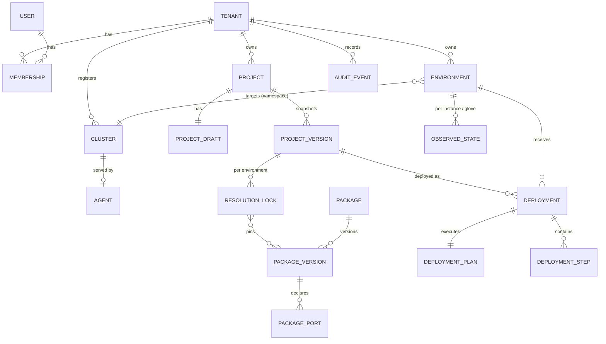

# 04 — Domain Model and Data Storage

> Status: **Recommended.** Table sketches are indicative; final DDL is written in roadmap Phase 3.
> Related: [03 Architecture](03-system-architecture.md) · [07 YAML](07-project-yaml-specification.md) · [08 API](08-api-and-integration-contracts.md) · [ADR-009](10-architecture-decision-records.md#adr-009-storage-architecture)

## 1. Entity classification

Not everything is a database row. Each concept is classified by where its truth lives:

| Concept | Class | Truth lives in | Notes |
|---|---|---|---|
| Tenant | Persistent | Postgres | Isolation unit for data, RBAC, quotas |
| User | Persistent (thin) | OIDC IdP; Postgres caches `sub`, email, display name | No passwords stored |
| Membership / RoleBinding | Persistent | Postgres | Roles: `tenant-admin`, `project-editor`, `project-viewer`, `environment-deployer` |
| Project | Persistent | Postgres | Identity + current draft pointer |
| Project draft | Persistent, mutable | Postgres (`jsonb` + `revision`) | One per project in MVP, so no branches |
| ProjectVersion | Persistent, **immutable** | Postgres (canonical YAML text + jsonb + `contentHash`) | Created on "save version" and on every deploy |
| ResolutionLock | Derived, persisted | Postgres, per (version, environment) | Deterministic. Cached because it fixes deploy behavior. |
| TechnologyDefinition (Package version) | Persistent, immutable | Postgres (ingested from catalog Git/OCI) | Data only, never code |
| TechnologyInstance | Part of ProjectVersion document | Inside `spec.technologies[]` | No separate table. Observed state is keyed by `(environment, instanceId)`. |
| Deployer / deployer version | Part of package version (`spec.deployer`) | — | HTTP deployer images are referenced by digest |
| Capability (port, binding) | Part of package version; indexed | `package_ports` index table for compatibility queries | Derived from package documents |
| Adapter | Package version with `kind: AdapterPackage` | Same as packages | — |
| Glove | Part of ProjectVersion document | `spec.gloves[]` | Its resolution is in the lock, and its status in `observed_state` |
| Environment | Persistent | Postgres | Cluster ref + target namespace + policies |
| DeploymentTarget (Cluster) | Persistent | Postgres | Cluster identity, agent binding, facts (versions, CRDs) last reported |
| Agent | Persistent + runtime | Postgres (identity, credential metadata, last seen); runtime in user cluster | — |
| DeploymentPlan | Persistent, immutable | Postgres (`jsonb` step DAG + diff) | Created by planner, approved or discarded |
| DeploymentExecution | Persistent | `deployments` + `deployment_steps` | State machine ([03 §9.3](03-system-architecture.md#93-failure-concurrency-cancellation-recovery)) |
| Resource allocation | Derived | Computed from packages + `resources`. Shown in plan and quota checks. | Not stored separately |
| SecretReference | Part of documents | `{secretRef:{name,key}}` | Secret values: **external** (user cluster) |
| Processing component | Future: a package category | — | No entity now ([05 §11](05-glove-interoperability-model.md#11-future-processing-engines)) |
| Health / status | Runtime, latest snapshot persisted | `observed_state` (upsert latest), `drift_reports` | History is not kept beyond the audit of transitions |
| Audit event | Persistent, append-only | `audit_events` | — |
| Logs | **External** | User cluster (pod logs), streamed on demand | Only step summaries (≤ 64 KiB) are persisted |
| Kubernetes objects, operator CRs, external resources | **External** | User cluster / external API | Referenced by identity only |

## 2. Relationships



## 3. Invariants (enforced in code *and*, where possible, in the database)

1. A `ProjectVersion` is immutable. Updates are rejected by a trigger. `(project_id, number)` is unique and `number` is monotonic.
2. A deployment references exactly one `ProjectVersion`, one `Environment` and one approved `DeploymentPlan` created from that same version, environment and lock.
3. At most one deployment per environment is in `Pending|Running|Cancelling` (partial unique index).
4. An environment's namespace belongs to exactly one tenant: `UNIQUE (cluster_id, namespace)`.
5. A project may only reference environments of its own tenant (FK + tenant check).
6. Every row carries `tenant_id`. Every query is tenant-scoped (repository layer + Postgres Row-Level Security as defense in depth).
7. A package version is immutable after ingestion. `(catalog, name, version)` is unique.
8. No column may hold a secret value. Enforced by review checklist + a CI grep test on migrations for suspicious column names (`password`, `token`, `secret_value`), with an allow-list for agent credential *hashes*.
9. Audit events are insert-only (`REVOKE UPDATE, DELETE` from the app role).

## 4. Lifecycle states

| Entity | States |
|---|---|
| Project | `Active` → `Archived` (read-only; deletion only after all environments are undeployed) |
| ProjectVersion | `Created` (immutable). Flags: `deployedIn[]` derived. |
| Package version | `Active` → `Deprecated` → `Revoked` |
| Cluster/Agent | `Registered` → `Connected` ⇄ `Disconnected` → `Revoked` |
| Environment | `Active` → `Frozen` (no deployments) → `Deleted` (only when nothing deployed) |
| Deployment | See [03 §9.3](03-system-architecture.md#93-failure-concurrency-cancellation-recovery) |
| Step | `Pending → Dispatched → Running → Succeeded \| Failed \| Cancelled \| DependencyFailed \| Skipped` |
| Instance health (observed) | `Unknown`, `Progressing`, `Healthy`, `Degraded`, `Failed`, `Missing`, `Terminating` |
| Glove status | [05 §7](05-glove-interoperability-model.md#7-glove-lifecycle-and-status) |

## 5. Storage architecture

### 5.1 Access patterns

| Data | Pattern | Size | Consistency need |
|---|---|---|---|
| Drafts | Frequent small writes (autosave), read by one editor | ≤ 1 MiB | Optimistic concurrency |
| Versions | Write once, read often, diff | ≤ 1 MiB each, tens to hundreds per project | Strong, immutable |
| Catalog | Read-heavy, write on ingestion | Hundreds of packages | Strong |
| Deployments/steps | Transactional state machine, polling by coordinator | Thousands of rows/month/tenant | **Strong, transactional with audit** |
| Observed state | Upsert latest per instance, every few minutes | Small rows | Eventual is fine |
| Audit | Append, range queries by time/actor | Grows forever (retention) | Append-only |
| Logs | Live tail only | Unbounded, so **not stored** | — |

### 5.2 Options evaluated

| Option | Verdict |
|---|---|
| **PostgreSQL only** (`jsonb` for documents, relational for state machines, partitions for audit) | **Chosen.** One system covers every pattern, with transactions across version + deployment + audit. |
| + Object storage (S3/MinIO) for YAML/versions | Not needed: documents ≤ 1 MiB fit `text`/`jsonb`. Add if exportable bundles or large artifacts appear. |
| + Redis cache | Not needed: no measured hot path. The catalog can be cached in-process. |
| + Search (OpenSearch) | Not needed: Postgres `ILIKE`/trigram covers catalog/project search at this scale. |
| + Time-series DB for health | Not needed: only the latest state is stored. Metrics stay in the user's Prometheus/OpenShift monitoring. |
| + Graph DB for the project graph | Not needed: graphs ≤ 200 nodes are loaded whole and processed in memory. |
| Git as the primary store | Rejected for MVP: needs locking, multi-tenant repos and latency. Offered later as *sync to Git*. |

### 5.3 Indicative tables

```sql
projects(id uuid pk, tenant_id, name, display_name, created_by, archived_at, unique(tenant_id, name))
project_drafts(project_id pk, tenant_id, revision bigint, document jsonb, updated_by, updated_at)
project_versions(id uuid pk, tenant_id, project_id, number int, document jsonb, canonical_yaml text,
                 content_hash bytea, schema_version text, created_by, created_at, message text,
                 unique(project_id, number))
resolution_locks(project_version_id, environment_id, tenant_id, lock jsonb, catalog_snapshot timestamptz,
                 primary key(project_version_id, environment_id))
packages(id, catalog, name, kind, unique(catalog, name))
package_versions(id, package_id, version text, document jsonb, digest bytea, status, ingested_at,
                 unique(package_id, version))
package_ports(package_version_id, port text, direction, initiation, protocol, formats text[], auth text[])
environments(id, tenant_id, name, cluster_id, namespace, policy jsonb, status, unique(tenant_id, name),
             unique(cluster_id, namespace))
clusters(id, tenant_id, name, facts jsonb, facts_reported_at)
agents(id, cluster_id, version, credential_hash bytea, status, last_seen_at)
deployment_plans(id, tenant_id, project_version_id, environment_id, steps jsonb, diff jsonb, created_at)
deployments(id, tenant_id, environment_id, project_version_id, plan_id, attempt int, status,
            idempotency_key text, requested_by, approved_by, started_at, finished_at, error jsonb)
  -- create unique index one_active_per_env on deployments(environment_id)
  --   where status in ('Pending','Running','Cancelling');
deployment_steps(deployment_id, step_id text, type, depends_on text[], status, attempt int,
                 dispatched_at, lease_expires_at, started_at, finished_at, result jsonb,
                 error_class, message text, primary key(deployment_id, step_id))
observed_state(environment_id, subject_kind, subject_id, tenant_id, health, conditions jsonb,
               outputs jsonb, observed_at, primary key(environment_id, subject_kind, subject_id))
drift_reports(id, environment_id, subject_id, fields jsonb, detected_at, acknowledged_by, acknowledged_at)
audit_events(id bigserial, tenant_id, at timestamptz, actor, action, subject, details jsonb)
  -- partitioned by month
outbox(id bigserial, topic, payload jsonb, created_at, processed_at)
```

## 6. Data ownership

| Data | Owner module | Readers |
|---|---|---|
| Drafts, versions, locks | `projects` (locks written via `resolver` output) | validation, planner, UI |
| Packages, ports | `catalog` | resolver, UI |
| Environments, clusters, agents | `environments` | deployments, gateway |
| Deployments, steps, plans | `deployments` | UI, observation |
| Observed state, drift | `observation` | UI |
| Audit | `audit` | tenant admins (export) |

## 7. Backup, migration, retention

- **Backup:** Postgres PITR (WAL archiving) with daily base backups, RPO ≤ 15 min and RTO ≤ 4 h for hosted. Self-hosted customers use their standard Postgres backup (CloudNativePG supports scheduled backups to object storage). Quarterly restore drill. **Nothing in the user cluster depends on the control-plane DB to keep running:** if the control plane is lost, deployed systems keep working. Only management is unavailable.
- **Disaster recovery of management state:** after restore, agents reconnect, report observed state and re-establish truth. Deployments that were running at the backup point are marked `Interrupted` and can be retried.
- **Schema migrations:** forward-only, versioned (goose/Atlas), run at startup behind an advisory lock. Expand → migrate → contract for breaking column changes. Every migration is tested against a production-shaped snapshot in CI.
- **Retention (defaults, tenant-configurable):**

| Data | Default |
|---|---|
| Project versions | Kept for the project's lifetime (small) |
| Deployment records + steps | 1 year |
| Step messages | Truncated to 64 KiB |
| Observed state | Latest only |
| Drift reports | 90 days after acknowledgment |
| Audit events | 1 year (hosted) |
| Logs | Never stored |

- **Tenant deletion:** soft-delete → 30-day grace → hard delete of all tenant rows (cascades by `tenant_id`). Audit export is offered before deletion. Backups age out per the backup retention (documented).
