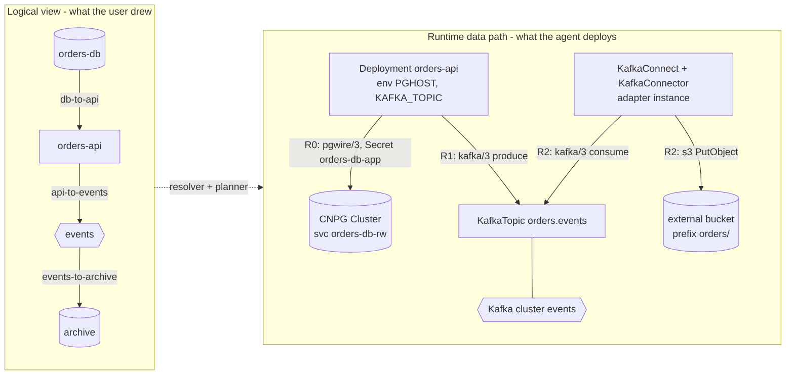
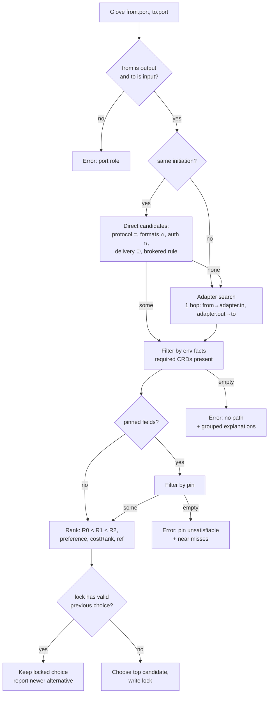
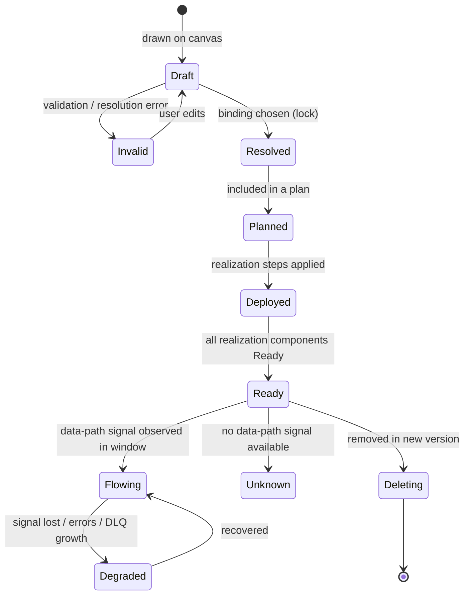

# 05 — Gloves: Universal Connection Model

> Status: **Recommended model, executable reference.** The rules in §6 are implemented in miniature in [`examples/check_examples.py`](examples/check_examples.py). Running it validates the sample packages and project and prints the resolution.
> Related: [03 Architecture](03-system-architecture.md) · [06 Deployer contract](06-deployer-plugin-contract.md) · [07 YAML](07-project-yaml-specification.md) · ADRs [005](10-architecture-decision-records.md#adr-005-glove-abstraction-and-runtime-execution), [006](10-architecture-decision-records.md#adr-006-capability-discovery-and-compatibility-matching)

## 1. What a Glove is

A **Glove** is a typed, validated, deployable connection from an **output port** of one technology to an **input port** of another. It has two representations, which are deliberately kept separate:

- **Logical connection.** What the user drew: `orders-api.order-events → events.ingest`. It is stored in the project YAML.
- **Runtime data path.** What actually exists in the cluster: possibly nothing new (injected configuration), a provisioned resource (a Kafka topic), or a deployed component (a sink connector). It is derived by the resolver and planner, stored in the resolution lock, and never hand-written by the user.

A line on a canvas is a Glove only once the resolver has turned it into a concrete **binding** (protocol, format, auth, delivery, realization) or a precise explanation of why it can't.

## 2. Resolving the four original modes

The original concept named four modes: Input A, Input B, Output A and Output B. Analysis shows they are **not four kinds of connection**. They are **four kinds of port**, produced by two independent axes:

- **Direction:** does data *leave* (output) or *enter* (input) the technology?
- **Initiation:** who starts each transfer, the reader (**pull**) or the writer (**push**)?

| | **pull** (reader initiates) | **push** (writer initiates) |
|---|---|---|
| **output** port | **Output B** — *provider*. "Read me via X." (Postgres `sql`, Kafka `subscribe`, an HTTP API) | **Output A** — *emitter*. "I send data via X." (service publishing events) |
| **input** port | **Input A** — *consumer*. "I read from something via X." (service reading Postgres, sink connector reading Kafka) | **Input B** — *receiver*. "Send data to me via X." (Kafka `ingest`, S3 bucket, webhook endpoint) |

A Glove always joins one output port to one input port:

- **Pull Glove** = Output B → Input A. The consumer initiates. The protocol/dialect is **auto-selected** from the intersection of declared bindings. Example: the app reads Postgres over `pgwire/3`. This resolves the overlap the brief noticed: *Input A and Output B are the two ends of the same pull connection.*
- **Push Glove** = Output A → Input B. The emitter initiates. The transport is **user-selectable** among the compatible intersection, with an auto default. Example: the app pushes to Kafka.
- **Mismatched initiation** = Output B → Input B (nobody initiates) or Output A → Input A (both initiate). These **cannot be direct**. Output B → Input B needs an active **pump** adapter (e.g. a Kafka Connect sink reads Kafka and writes S3). Output A → Input A needs a **buffer** (a broker or store between them). The resolver inserts such an adapter automatically if one is registered. Otherwise it explains the gap.

So "auto-selected vs user-selected" is a **selection policy**, not a mode. Any Glove may be `binding: auto` or pinned. The UI *defaults* pull Gloves to auto and *prompts* for a choice on push Gloves only when more than one compatible transport exists.

**Request/response protocols** (SQL, HTTP APIs, gRPC) are modelled as pull. The **server is the `from` side** (the provider), even though requests flow the other way. The Glove direction describes *who provides the data service*, not packet direction. This is a documented convention, not a limitation.

## 3. Transports vs. connectors vs. sinks (validating the proposed options)

| Candidate | What it actually is | How Thanos models it |
|---|---|---|
| **HTTP/2** | A transport *framing* for HTTP semantics: binary frames, multiplexed streams, header compression, flow control (RFC 9113; HTTP semantics in RFC 9110). It defines **no message schema, no delivery guarantee and no retry semantics**. | A *protocol id* (`http/2`) inside a binding. A push-over-HTTP binding must also specify format (e.g. `json`, or CloudEvents) and an idempotency convention. Note: many HTTP endpoints serve only HTTP/1.1, so `http/2` and `http/1.1` are distinct ids, and a pin to `http/2` is never silently downgraded. |
| **Kafka** | A **broker technology** with its own wire protocol, offering at-most-once and at-least-once delivery, plus exactly-once via idempotent producers and transactions. | Kafka is a *technology node* (with `ingest` = Input B and `subscribe` = Output B ports). It is never an invisible transport. A push Glove into Kafka provisions a topic (R1). "Service A → Kafka → Service B" is two Gloves through a visible Kafka node. |
| **"Kafka-to-S3"** | Not a transport. It is a **sink connector**: a Kafka Connect plugin that consumes topics and writes objects to S3. | An **adapter** (`core/kafka-to-s3`) that the resolver inserts on a Kafka `subscribe` → S3 `objects` Glove (R2). License matters: the Confluent S3 sink uses the Confluent Community License, so we reference the Apache-2.0 Aiven cloud-storage connectors instead *(verify fitness in PoC-3)*. |
| **S3** | An object-storage **API** (here identified as `s3/2006-03-01`) and a storage destination. | A binding protocol on an Input B port of a storage technology. |

## 4. Formal Glove data model

The **user-authored** part lives in the project YAML ([07](07-project-yaml-specification.md)). The **derived** parts live in the resolution lock and observed state. Fields:

| Aspect | Field (YAML / lock) | Notes |
|---|---|---|
| Identity | `id` (unique in project), lock: `uid` | `id` is a DNS label, so runtime names derive from it. |
| Source / destination | `from: {technology, port}`, `to: {technology, port}` | `from` must be an output port and `to` an input port. |
| Directionality | Implied by port direction. Initiation comes from the ports. | Bidirectional exchange = two Gloves. |
| Capabilities | Port bindings from packages (`protocol`, `formats`, `auth`, `delivery`, `provisions`, `brokered`) | Declared by packages, never by the core. |
| Transport selection | `binding: auto` or `{protocol, format, via, adapter}` | A pinned value is validated and never replaced. |
| Driver / connector | lock: `resolved.protocol`, `resolved.format`, `resolved.auth` | The "dialect" is the resolved binding. |
| Adapter | lock: `resolved.adapter` (package ref + instance name) | Max 1 hop in MVP. |
| Data types / schemas | `config.schemaRef` *(post-MVP)*: Apicurio/registry subject or inline JSON Schema | MVP checks **format** compatibility only, not record schema. |
| Schema evolution | Registry compatibility mode (BACKWARD default) *(post-MVP)* | See §9. |
| Auth / secrets | lock: `resolved.auth`. Credentials flow as **Secret names** via provider outputs (`credentialsSecret`). | Values never leave the cluster. |
| Network | lock: `resolved.endpoint` (from provider outputs). Optional `networkPolicy: generate` *(post-MVP)*. | MVP assumes same-namespace reachability. Cross-namespace is post-MVP. |
| Delivery / ordering | `delivery.guarantee` (`at-most-once` / `at-least-once`) | Must be in the intersection of both ends' `delivery`. Exactly-once is not offered in MVP. Ordering: per-partition/per-key only when the binding says so. |
| Retries / timeouts / idempotency | Adapter config + package defaults | The Glove declares intent, and the adapter or client library implements it. |
| Backpressure / buffering | Inherent in pull and brokered bindings. Push-direct bindings declare `buffering: none`. | The UI warns on push-direct with no buffer for at-least-once. |
| Error handling / DLQ | `delivery.deadLetter: true` | Supported only where the binding or adapter declares it (Kafka Connect DLQ applies to sink connectors). Otherwise it is a validation error. |
| Resources | Adapter package resource profile | Shown in plan and quota checks. |
| Observability | lock: `health.signals[]` (which signals exist for this realization) | See §8. |
| Version compatibility | Protocol ids carry a major version (`kafka/3`). Package semver ranges. | Matching is on exact protocol id. Vocabulary aliases are post-MVP. |
| Lifecycle | `Draft → Resolved → Planned → Deployed → Ready → Flowing \| Unknown \| Degraded` | §7. |
| Unsupported combinations | Resolver `explanations[]` | §6.4. |

## 5. Realization classes: logical vs. runtime path

| Class | Runtime effect | Example (from [`order-pipeline.project.yaml`](examples/order-pipeline.project.yaml)) | New runtime component? |
|---|---|---|---|
| **R0 — config-only** | Provider outputs (endpoint, Secret name) are injected into the consumer/emitter's configuration (env vars, CR fields). | `db-to-api`: `PGHOST`, `PGPORT`, and `secretKeyRef` to `<db>-app` injected into orders-api | No |
| **R1 — provision** | A resource is created *inside a provider* for this Glove (Kafka topic, bucket prefix, DB role), and then R0 injection. | `api-to-events`: KafkaTopic `orders.events` created, bootstrap + topic injected | No new workload, new resource |
| **R2 — adapter** | An adapter package instance is deployed between the ends, and each end is connected to the adapter by R0/R1. | `events-to-archive`: KafkaConnect + KafkaConnector (S3 sink) | **Yes** |
| **R3 — processing** *(post-MVP)* | A processing engine job (Flink/NiFi) is the adapter, with user-defined logic. | — | Yes |

R0/R1/R2 are **different planner step types**: `InjectConnections`, `ProvisionGloveResource`, `ApplyAdapter`. The R0 path deploys nothing new, so it cannot fail at runtime in ways an adapter can. This is the "no new component ⇒ different implementation" requirement.

## 6. Compatibility resolution algorithm

### 6.1 Inputs and determinism

`resolve(gloveSpec, fromPort, toPort, adapterIndex, envFacts) → Resolution | Explanation`. It is a pure function. The same inputs (project version + catalog snapshot + environment facts such as "CRD X present") always give the same output. The output is written to the **resolution lock** with the project version and environment.

### 6.2 Rules

1. **Port roles:** `from` must be `direction: output` and `to` must be `direction: input`.
2. **Direct match** (only when initiations are equal): a binding pair matches when `protocol` ids are equal, `formats ∩ ≠ ∅`, `auth ∩ ≠ ∅`, and, if the Glove sets `delivery.guarantee`, both sides support it.
3. **Brokered bindings:** a binding with `brokered: true` matches only a port of a technology that provisions the broker resource (e.g. Kafka `ingest`, `provisions: topic`), or a Glove with `binding.via` naming such a technology.
4. **Adapter path** (when no direct match exists, or the user pins an adapter): find adapters whose `inputPort` directly matches `from` and whose `outputPort` directly matches `to`. **Max one adapter hop** in MVP. Multi-hop search is bounded (depth ≤ 2) and post-MVP, because longer chains hide cost and failure modes.
5. **Environment feasibility:** candidates whose package `requires.crds` are absent in the target cluster are excluded. The explanation names the missing CRD/operator.
6. **Ranking** (deterministic): realization class (R0 < R1 < R2), then binding `preference` (higher first), then adapter `costRank` (lower first), then lexicographic package ref.
7. **Pinning:** pinned fields filter candidates. If the filter leaves nothing, the result is an **error**, never a silent fallback.

### 6.3 Overrides and the lock

- `binding: auto` → the resolver chooses, and the choice is written to the lock.
- On later saves, a **locked choice is kept** if it is still valid, even when a now-higher-ranked candidate appears (e.g. a new adapter version). Deployments are stable, and upgrades are explicit (`re-resolve` action, shown as a plan diff).
- If a locked choice becomes invalid (package removed, port changed), validation reports it and proposes the new best candidate. The user accepts by saving.

### 6.4 Explanations

Every rejected candidate records the **first failing dimension**: `initiation`, `protocol`, `format`, `auth`, `delivery`, `brokered`, `requires-crd`, `pin`. The UI groups them:

> ✗ `events.subscribe` (kafka/3, pull) → `archive.objects` (s3, push): no direct binding. Both ends are passive (pull output → push input), so an active adapter is required.
> ✓ Adapter `core/kafka-to-s3@0.1.0` can bridge: kafka/3 json → s3 json. Requires CRDs `KafkaConnect`, `KafkaConnector` (present).
> ✗ Pin `protocol: http/2` cannot be satisfied: no adapter offers an `http/2` input from `kafka/3`.

### 6.5 Dependency ordering derived from Gloves

The **initiating side depends on the passive side**. A pull Glove makes the consumer (`to`) depend on the provider (`from`). A push Glove makes the emitter (`from`) depend on the receiver (`to`). R2 adapters depend on both ends. `dependsOn` adds explicit edges, and cycles are a validation error. The example resolves to `archive, events, orders-db → orders-api`, with the adapter after `events` and `archive`.

## 7. Glove lifecycle and status

**Three distinct statements the UI must never blur:**

| Status | Meaning | Evidence |
|---|---|---|
| **Configured** (Resolved) | The design is valid and a binding exists. | Resolver output |
| **Deployed / Ready** | Every runtime piece exists and reports ready (topic Ready, connector Ready, consumer pod Ready with injected env). | kstatus / CEL readiness / deployer status |
| **Flowing** | Data is observed moving on this path recently. | Only when a signal exists, e.g. Kafka Connect connector/task state `RUNNING` plus non-zero sink offsets, topic end-offset increasing, or an app-exposed metric. **Otherwise the status is `Unknown`, shown as "Ready — data flow not observable".** |

MVP data-path signals: Kafka topic end-offset delta (via a lightweight admin call from the agent, *PoC*), Kafka Connect connector/task status, DLQ topic growth. R0 SQL Gloves report Ready only. Synthetic probes are post-MVP.

**Modification:** changing a Glove's config produces a plan diff on its realization only. Changing its ends is a delete + create. **Deletion:** R0 → re-render the consumer without the injection. R1 → provisioned resource follows the provider's `deletionPolicy` (topics are retained by default). R2 → the adapter is deleted.

## 8. Capability registry

### 8.1 Format and validation

- Package manifests are YAML documents validated by [`schemas/package.v1alpha1.schema.json`](schemas/package.v1alpha1.schema.json) (JSON Schema 2020-12). They are published as OCI artifacts or from a Git catalog repository, and ingested by the `catalog` module.
- `configSchema` is itself JSON Schema 2020-12 (meta-validated at ingestion). Extra rules are **CEL** `validations`.
- Vocabulary (protocol ids, formats, auth methods) is a **controlled list** owned by the catalog (`vocabulary` table + `docs`). Packages that use unknown ids are rejected at ingestion. This prevents `kafka3`, `Kafka/3` and `apache-kafka` from silently failing to match.

### 8.2 Versioning policy

| Thing | Scheme | Rule |
|---|---|---|
| Package schema (`apiVersion`) | `thanos/v1alpha1` → `v1beta1` → `v1` | Alpha may break. From beta on, only additive changes within a version, with conversion functions between versions. |
| Package | SemVer | Major = port removed/renamed, binding removed, config field removed or tightened. Minor = additive. Patch = templates/fixes. Ingestion **diffs ports and configSchema against the previous version and rejects mislabeled breaking changes.** |
| Protocol ids | `<name>/<major>` | Matching is exact. A protocol's minor versions are the package's concern. |
| Vocabulary | Append-only | Deprecations are allowed, removals are not. |

### 8.3 How the UI uses capabilities (no per-technology UI code)

1. Palette: lists packages by `category` and shows ports as handles, colored by initiation and labeled with protocol.
2. On drag from a port, the UI requests compatible targets. The server runs rules 1–5 against all ports in the graph and returns `{port, realization, needsAdapter, blockedBy}`. Valid targets glow. Adapter-requiring targets show a bridge icon.
3. On drop, the Glove is created with `binding: auto`. If a push Glove has more than one compatible transport, a picker shows them (with realization class and cost).
4. Edge badges come from the lock: protocol, R0/R1/R2, adapter name.

### 8.4 Sample declarations

All are marked `illustrative: true`. They are planning examples, not product guarantees.

| File | Kind | Demonstrates |
|---|---|---|
| [`container.yaml`](examples/packages/container.yaml) | Technology (user service) | `dynamicPorts`, env injection, image-pinning CEL rule |
| [`postgresql.yaml`](examples/packages/postgresql.yaml) | Technology (operator: CloudNativePG) | CRD prerequisite, CEL readiness, outputs incl. Secret *name* |
| [`kafka.yaml`](examples/packages/kafka.yaml) | Technology (operator: Strimzi) | Both Input B (`ingest`, provisions topic) and Output B (`subscribe`) |
| [`s3-bucket.yaml`](examples/packages/s3-bucket.yaml) | Technology (external, HTTP deployer) | `x-thanos-secret`, deployer-driven readiness |
| [`adapter-kafka-to-s3.yaml`](examples/packages/adapter-kafka-to-s3.yaml) | Adapter (pump) | Pull-in / push-out adapter, DLQ support |
| [`adapter-http-to-kafka.yaml`](examples/packages/adapter-http-to-kafka.yaml) | Adapter (protocol bridge) | Push-in / push-out bridge, http/1.1 only (so a pinned http/2 is rejected) |

## 9. Interoperability strategy: from MVP to "any compatible pair"

| Approach | Value | Cost / risk | MVP? |
|---|---|---|---|
| **Direct native bindings** (shared protocol ids) | Most pairs that already speak a common protocol, with zero runtime cost | Needs disciplined vocabulary | **Yes** (core) |
| **Standardized protocols / envelopes** (CloudEvents over HTTP or Kafka, AsyncAPI descriptions) | Raises the share of pairs that match directly | Requires technologies to adopt them | Vocabulary entries only (`cloudevents-json`) |
| **Reusable protocol adapters** (bridges, Kafka Connect connectors) | One adapter serves *every* pair matching its in/out bindings, so it grows O(protocols), not O(technologies²) | Each adapter is real software to operate | **Yes, 1–2 adapters** |
| **Format/schema conversion** | Bridges json ↔ avro etc. | Lossy conversions, schema registry dependency | No (post-MVP, as adapters with `format` in ≠ out) |
| **Intermediate gateways/brokers** | Decouples push/push and rate mismatch | Extra stateful infra | Yes, as **visible** technology nodes (Kafka), never hidden |
| **Generated connectors** (e.g. from OpenAPI/AsyncAPI) | Long tail of HTTP APIs | Quality and auth variance | No (research track) |
| **User-provided adapters** | Escape hatch | Supply-chain and trust | Post-MVP, as user container adapters with declared ports, running in the user cluster |
| **Declared compatibility matrices** | Explicit pairwise exceptions | O(n²) maintenance | Only as **deny-rules** for known-broken combinations |

**Why this avoids bespoke pair integrations:** matching is on *protocol ids*, not technology names. Adding a technology means declaring its ports. It is immediately compatible with every existing technology and adapter sharing those ids. Adding one adapter `P→Q` connects every `P`-speaker to every `Q`-speaker. The work grows with the number of *protocols*, not technology pairs.

**Honest limit:** binding compatibility proves *the pipes fit*, not that *the data makes sense*. Record-schema compatibility (field names, types) needs schema references and a registry, which is post-MVP. Until then, the UI labels a resolved Glove "transport-compatible; payload schema not verified".

## 10. Answers to the Glove architecture questions

1. **Where does a Glove execute?** It doesn't "execute" as one thing. R0 is configuration consumed by the endpoint workloads. R1 is a resource inside the provider. R2 is an adapter workload. **All runtime pieces run in the user's cluster.** Nothing on the data path runs in the control plane.
2. **Control plane vs. user cluster:**
   - The control plane does design, validation, resolution, planning, records and status aggregation.
   - The user cluster runs the data path, credentials, rendering of templates against live values, readiness evaluation and drift detection.
3. **Direct communication without a Thanos component?** Yes. R0 and R1 are exactly that. The endpoints talk natively, and Thanos only wired their configuration.
4. **When is a protocol bridge deployed?** Only when no direct binding exists (protocol mismatch or initiation mismatch) **and** a registered adapter bridges the gap, or when the user pins an adapter.
5. **Where does schema transformation occur?** In an adapter (R2) or processing component (R3) in the user cluster, never in the control plane and never implicitly in R0/R1.
6. **How are compatibility decisions calculated?** By the deterministic rule set in §6 over declared port bindings, adapter declarations and environment facts.
7. **How are overrides reconciled?** Pins filter the candidate set. If a pin is unsatisfiable, the result is an error with explanations. Locked auto-choices are stable until an explicit re-resolve.
8. **How do we avoid bespoke pair integrations?** Protocol-id matching plus reusable adapters (§9).
9. **Configured vs. deployed vs. healthy:** three separate statuses with separate evidence (§7). "Flowing" is only claimed when a data-path signal exists.
10. **Future streaming/batch?** Processing engines join as technologies (with ports) or as adapters whose in/out bindings differ in format or semantics (R3). The Glove model needs no new concept. See [§11](#11-future-processing-engines).

## 11. Future processing engines

A Flink job, NiFi flow or Kafka Streams app is either:
- a **technology** with input and output ports (the user deliberately places a "Stream processor" node), or
- an **adapter** with `format` or schema conversion between ports (the resolver may place it).

What the existing contracts already cover:
- Lifecycle: a deployer for the Flink Kubernetes Operator `FlinkDeployment` CR.
- Readiness: CEL over CR status.
- Resources: package profiles.

What genuinely differs, and is deferred until a processing engine is actually added:
- job-graph/user logic artifacts;
- stateful upgrade semantics (savepoints);
- autoscaling.

The rule is to add these as *package-level* fields when the first processing package is built, not as a new core abstraction now. Comparison of engines: [01 §7](01-product-requirements.md#7-future-processing-capabilities).
