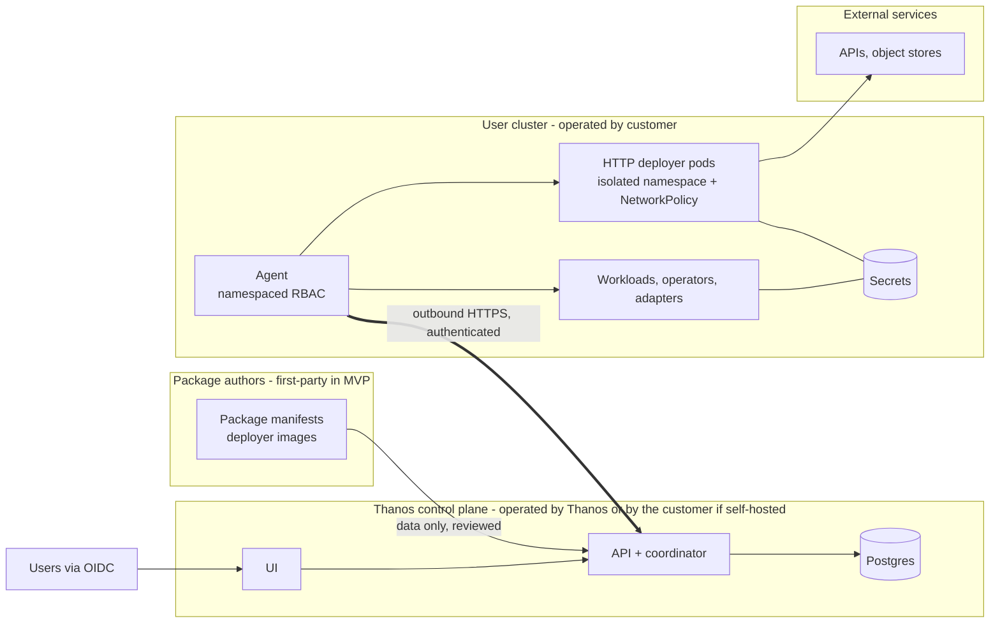

# 09 — Security and Trust Boundaries

> Status: **Recommended baseline.** Items labelled *MVP* are acceptance criteria ([02](02-mvp-scope-and-acceptance-criteria.md)). *Prod* items gate general availability.
> Related: [03 Architecture](03-system-architecture.md) · ADRs [010](10-architecture-decision-records.md#adr-010-user-cluster-connectivity), [011](10-architecture-decision-records.md#adr-011-secret-management)

## 1. Trust domains

**Boundary rules:**
1. Nothing in T1 executes code from T2 or from users. Packages are data; templates are rendered in T3.
2. T1 never receives secret values or payload data from T3.
3. T3 components initiate every connection to T1.
4. Deployer code (T2) runs only in T3, isolated from the agent's credentials.

## 2. Cluster connectivity options

| Option | Pros | Cons | Verdict |
|---|---|---|---|
| **Central control plane with direct API access** (stores kubeconfigs, calls the cluster API) | No in-cluster component | Needs **inbound** reach to every API server, which is often impossible (firewalls, private clusters). Central store of powerful credentials = high-value target. | Rejected |
| **GitOps hub** (Argo CD style: hub with cluster secrets) | Mature tooling | Same inbound + central-credential problem (Argo CD stores cluster credentials as Secrets in the hub). The pull-based Argo CD Agent is still pre-GA (v0.10, 2026-08). | Not for MVP |
| **Per-cluster agent, outbound-only** | Works behind firewalls/NAT and through HTTP proxies. Credentials stay in the cluster. Least privilege is local. A proven pattern (Open Cluster Management klusterlet pulls from the hub; the hub never calls clusters). | One component to ship, upgrade and support | **Chosen** |
| **Self-hosted control plane next to the cluster** | Air-gapped support | Customer operates it | Supported deployment mode of the same software (prod) |

**Restricted networks:**
- **No inbound:** fine, since the agent dials out.
- **Outbound only via proxy:** the agent honors `HTTPS_PROXY`/`NO_PROXY` and custom CA bundles.
- **Outbound restricted to an allow-list:** the agent needs exactly one destination (the control-plane hostname, 443/TCP).
- **No outbound at all (air-gapped):** run the control plane self-hosted inside the network, with a mirrored registry for images and packages.
- **Agent offline:** deployed systems keep running. Deployments wait (`AgentUnavailable`) and resume.

## 3. What Thanos accesses, what the user keeps, what never leaves

| Thanos control plane **must** have | Stays under **user** control | **Never** leaves the user environment |
|---|---|---|
| Project documents (design, config, Secret *names*) | Cluster credentials and RBAC grants to the agent | Secret values (DB passwords, cloud keys, tokens) |
| Agent identity + reported facts (K8s/OpenShift version, CRDs present) | Operator installation and upgrades | Application data and message payloads |
| Step results, conditions, readiness, sanitized error text | Namespace creation, quotas, network policies | Log contents (only streamed transiently on explicit request, never stored) |
| Identities of owned resources (kind/name/namespace) | Secret creation/rotation (or External Secrets Operator) | Full manifests of resources Thanos does not own |
| Audit of user actions in Thanos | Image registries and image contents | Kubeconfigs or cluster admin credentials |

## 4. Multi-tenancy, authentication, authorization

- **Tenancy:** a hard `tenant_id` on every row. A repository layer adds the tenant predicate, with Postgres RLS as a second line *(MVP)*. Cross-tenant tests are in the security suite: every API endpoint is called with a token for tenant B against tenant A's resources and must return 404 *(MVP)*.
- **AuthN:** OIDC only. MFA is the customer IdP's job. API tokens for automation are OIDC client credentials, never Thanos-minted long-lived keys *(MVP)*.
- **AuthZ roles:**

| Role | Scope | Can |
|---|---|---|
| `tenant-admin` | Tenant | Clusters, environments, policies, role bindings, audit export |
| `project-editor` | Project | Edit drafts, create versions, create plans |
| `project-viewer` | Project | Read |
| `environment-deployer` | Environment | Approve/execute/cancel deployments into that environment |

  Production environments set `requireApproval: true`. The approver must differ from the plan creator when `fourEyes: true` *(prod)*.

## 5. Cluster registration and agent credentials

1. A tenant-admin registers a cluster and gets a **single-use join token**, TTL 1 h, stored hashed.
2. The admin applies the agent manifests: Namespace, ServiceAccount, Deployment, plus one Role/RoleBinding per target namespace, generated per environment and reviewed by the admin.
3. The agent exchanges the join token for a short-lived credential bound to `agentId` (MVP: signed JWT, 1 h, refreshed; prod: mTLS client certificate with ≤ 30-day rotation).
4. **Revocation** (`:revoke-agent`) takes effect on the next call (≤ 30 s). A revoked agent stops executing. Re-registration requires a new join token.
5. **Agent RBAC (least privilege, MVP):**
   - Namespaced Role in each target namespace: verbs `get, list, watch, create, patch, delete` on the GVKs used by enabled packages, `get` on Secrets (existence checks), `create` on `selfsubjectaccessreviews`.
   - **No cluster-scoped write permissions. No cluster-admin.**
   - The agent's own namespace holds the deployer pods.

## 6. Secret storage and delivery

- **MVP:** Thanos stores **no secret values anywhere**.
  - User-provided credentials are Kubernetes Secrets the user creates, or syncs with External Secrets Operator from Vault or a cloud secret manager.
  - Operator-generated credentials (e.g. CNPG's `<cluster>-app`, Strimzi KafkaUser secrets) stay where operators put them.
  - Delivery to workloads is via `secretKeyRef`/volume rendered by the agent. **The agent itself does not read secret values**, except where an HTTP deployer needs them, and then the *deployer pod* mounts them directly.
- **Rotation:** rotating a Secret is the user's or operator's action. A Thanos "restart on secret change" option (annotation hash) is post-MVP.
- **Prod option (hosted secret store):** if customers demand Thanos-managed secrets, integrate with an external KMS/Vault per tenant and deliver through the agent, encrypted end-to-end to the cluster. Deferred until a design partner requires it.

## 7. Transport security

- UI/API: TLS 1.2+ (1.3 preferred), HSTS.
- Agent ↔ control plane: TLS with server certificate validation, plus the agent credential. Optional certificate pinning for self-hosted deployments.
- Agent ↔ deployer: cluster-local, with a per-deployer bearer token in a Secret and a NetworkPolicy allowing only agent → deployer *(MVP)*. mTLS via service mesh is the customer's choice.
- Control plane ↔ Postgres: TLS, separate DB roles for migration vs. runtime, and the runtime role has no DDL.

## 8. Deployer and package trust

| Tier | MVP | Later |
|---|---|---|
| First-party catalog | Only catalog. PR review by two maintainers. Package ingestion validates schema, vocabulary, no cluster-scoped kinds, digest-pinned images. | Signed catalog releases (cosign/Sigstore) |
| Partner / third-party catalogs | Disabled | Opt-in per tenant, signature-verified, labeled, and policy-limited to an allowed list of GVKs |
| Tenant-private packages | Disabled | Allowed in the tenant's own catalog, rendered only in that tenant's clusters |

- **Template safety:** CEL with cost limits, no I/O, no loops. Rendered objects are forced into the environment namespace, and a package may only create kinds in its declared allow-list.
- **Deployer isolation:** deployer pods run with the `restricted-v2` SCC, their own ServiceAccount with **no Kubernetes API permissions** (automount disabled), only their declared credentials Secret, and a NetworkPolicy limiting egress to the environment's egress allow-list.

## 9. Supply chain and artifacts

- Thanos images: built in CI from pinned base images (UBI minimal), SBOM generated, signed with cosign *(prod)*, vulnerability scanned (gating on critical) *(MVP)*.
- Package images (deployers, adapters): digest-pinned. Signatures verified at ingestion *(prod)*.
- User images: environment policy `allowedRegistries` + `requireDigest`. Signature verification is delegated to the cluster's admission policy (e.g. OpenShift image policies) *(documented recommendation)*.
- Dependencies: Renovate/Dependabot, `govulncheck`, `npm audit` in CI *(MVP)*.

## 10. SSRF and external endpoints

Any user-configured URL (e.g. S3 endpoint) is dangerous if *the control plane* calls it. Rules:
1. **The control plane never calls user-configured endpoints.** Only the agent or deployer does, from the user's network, under the user's egress controls *(MVP)*. This eliminates control-plane SSRF by construction.
2. Validation still rejects endpoints whose host is not in the environment's `egressAllowList`, and literal IPs in link-local, loopback or cloud-metadata ranges (`169.254.169.254`, `fd00:ec2::254`) *(MVP)*.
3. Deployers re-check the resolved IP against the deny ranges at connection time (DNS rebinding) via the SDK's HTTP client *(MVP for first-party deployers)*.

## 11. Untrusted YAML and configuration

- Parser: YAML 1.2 safe subset. Reject anchors/aliases, custom tags and duplicate keys. Size ≤ 1 MiB, depth ≤ 32, max 200 technologies and 500 Gloves *(MVP)*.
- Schemas use `additionalProperties: false`, and `format`/`pattern` limits on every string reaching Kubernetes names.
- CEL from packages is compiled at ingestion with a cost budget. User input is never evaluated as CEL (users provide values, not expressions).
- Rendered output is validated against the target API by SSA dry-run before any real apply.

## 12. No arbitrary code execution in the control plane

| Path | Mitigation |
|---|---|
| Package templates | Data + CEL (sandboxed), rendered in the agent |
| Deployer logic | Runs only as pods in user clusters |
| User code | Container images run in user clusters. Builds (post-MVP) run in user clusters. |
| YAML import | Safe parser, schema validation |
| Plugin loading | Not supported (no Go plugins, no dynamic loading) |

## 13. Audit

Recorded *(MVP)*:
- logins (from OIDC callback), role changes;
- cluster registration/revocation, environment and policy changes;
- version creation;
- plan creation, approval, cancel and retry, and per-step terminal transitions;
- log-stream sessions (who viewed which workload's logs, when);
- package ingestion.

Format: `{at, tenant, actor{sub, ip, userAgent}, action, subject, details, traceId}`. Insert-only. Export as JSONL *(MVP)*. SIEM streaming is *prod*.

## 14. Quotas and abuse

Per tenant:
- max projects, technologies per project, deployments per hour, log-stream minutes;
- API rate limits per token;
- environment policy limits per instance (CPU, memory, storage).

Kubernetes `ResourceQuota` in target namespaces remains the user's hard limit. Thanos surfaces quota rejections from SSA dry-run at preflight.

## 15. Secure deletion and lifecycle cleanup

- Undeploy follows the deletion plan ([03 §9.3](03-system-architecture.md#93-failure-concurrency-cancellation-recovery)). `Retain` resources are unlabeled, not deleted, and listed in the result.
- Revoking a cluster: the agent credential is revoked and pending deployments are failed. The user removes agent manifests with a documented one-liner. Resources in the cluster remain.
- Tenant deletion: [04 §7](04-domain-model-and-data-storage.md#7-backup-migration-retention).

## 16. Environment-specific requirements

| Area | Local development | MVP (pilots) | Production |
|---|---|---|---|
| Control plane | `docker compose` + `kind` | Single replica, hosted by us or self-hosted by pilot | HA (2+ replicas), managed Postgres with PITR |
| AuthN | Keycloak dev realm | Customer OIDC or our Keycloak | Customer OIDC, SCIM (later) |
| Agent auth | Static dev token allowed (flag `--insecure-dev`, refuses to start if the server URL isn't localhost) | Join token + short-lived JWT | mTLS client certs with rotation |
| Catalog | Local directory | First-party, reviewed | Signed first-party, optional signed partner catalogs |
| Secrets | Plain dev Secrets in kind | User-managed Secrets / ESO | Same + optional KMS-backed integration |
| Image policy | Off | `allowedRegistries` on; `requireDigest` for non-dev | Signature verification recommended via cluster admission |
| Audit | Local only | Stored + JSONL export | SIEM export, 1-year retention |
| Pen test | — | Internal threat model review (STRIDE on the agent channel and deployer protocol) | External penetration test before GA |
