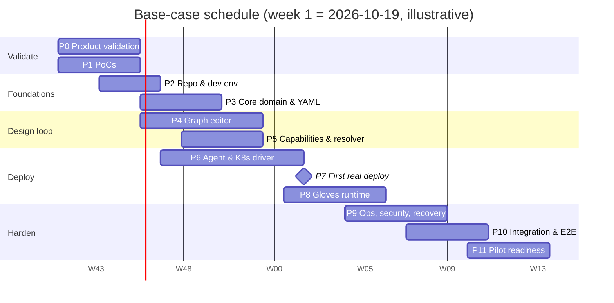

# 13 — Roadmap for a Three-Person, AI-Assisted Team

> Status: **Base-case plan with explicit assumptions.** Estimates are ranges, not promises. Re-estimate at every milestone.

## 1. Estimation assumptions

1. Three full-time senior engineers, comfortable with Go, TypeScript and Kubernetes. Founders handle discovery and sales in parallel.
2. AI coding agents raise *implementation* throughput by roughly 1.3–1.8× on well-specified, bounded tasks, and much less on integration, debugging against real clusters, and design. Planning applies **~1.4× net**, after review, rework and integration overhead. We do **not** count agents as extra engineers.
3. ~20% of each engineer's time goes to review, integration, CI, support of PoC findings and meetings.
4. Access to one real OpenShift 4.x dev cluster from week 6 (customer sandbox or Red Hat developer offering). Without it, R-12 grows.
5. No scope additions without the change process (§9).

## 2. Team responsibilities

| Engineer | Owns | Also |
|---|---|---|
| **A: Platform & backend** | Domain model, project/version/YAML codec, catalog ingestion, **validation + resolver + planner** (pure core), deployment coordinator, API + OpenAPI, Postgres | Architecture governance (ADR keeper), CODEOWNER for contracts |
| **B: Frontend & DX** | Canvas, palette, schema-driven forms, validation UX, plan/deploy UI, runtime view, YAML view, onboarding docs and quickstart | PoC-6 user tests, Playwright E2E, package-author guide |
| **C: Infrastructure & integrations** | **Agent** (channel, Kubernetes driver, readiness, drift), HTTP deployer SDK + S3 deployer, adapters, packages, kind/OpenShift test envs, CI/CD, release | Security baseline (RBAC, images, scans) |

**Modification vs. the suggested split:** the **resolver** moves to A (not C) because it is pure domain logic shared by validation, planner and UI. **Package authoring** stays with C because packages are tested against real operators. This removes the most dangerous cross-team dependency, a resolver co-owned by two people.

**Shared interfaces that cannot be developed independently** (frozen early, changed only via the contract process):

| Interface | Producers → consumers | Freeze target |
|---|---|---|
| Project schema + package schema (`schemas/*.json`) | A ↔ B ↔ C | End of Phase 2 (already drafted) |
| OpenAPI (`api/openapi.yaml`) | A → B | v0 end of Phase 2, v1 end of Phase 5 |
| Plan step format + agent channel messages | A ↔ C | Phase 3 (week 7) |
| Deployer Protocol v1 | C → package authors | After PoC-4 / Phase 6 |
| Diagnostic codes | A → B | Phase 3, then append-only |
| Resolution lock format | A → B, C | Phase 5 |

## 3. Phases

Week numbers are the base case.

| # | Phase | Weeks | Owner(s) | Depends on | Deliverables | Exit criteria |
|---|---|---|---|---|---|---|
| 0 | **Product validation & requirements** | 1–4 (parallel) | F (+B for prototype) | — | 12 interviews, design-partner shortlist, refined segment | ≥ 3 design partners willing to pilot (**gate G0**) |
| 1 | **Architecture validation PoCs** | 1–4 | A: PoC-4 · B: PoC-5, PoC-6 · C: PoC-1, 2, 3 | — | PoC reports, updated ADRs 004/005/007/010 | All PoCs pass or have an accepted fallback (**gate G1**) |
| 2 | **Dev environment & repo foundations** | 3–5 | A (lead), all | — | Monorepo, `make dev/cluster/e2e`, CI `pr` workflow, OpenAPI v0, lint boundaries, CLAUDE.md/AGENTS.md context pack | A new engineer or agent runs tests in < 30 min |
| 3 | **Core domain & YAML model** | 5–8 | A | 2 | Projects/drafts/versions API, canonical YAML, structural + referential validation, migrations framework, diagnostics | AC-P1..P4, AC-Y1..Y3 |
| 4 | **Visual graph editor** | 5–10 | B | 2 (OpenAPI v0), mock server | Canvas, palette, forms, undo/redo, YAML view, diagnostics overlay | AC-G1..G4 (with mocked resolver at first) |
| 5 | **Capability registry & compatibility** | 7–10 | A (resolver), C (packages), B (guided connections) | 3 | Catalog ingestion, vocabulary, resolver + lock, compatible-ports API, the 6 packages linted | AC-C1..C3, AC-V1..V4. **Milestone M1, "design loop".** |
| 6 | **First deployer implementation** | 6–12 | C (+A coordinator) | 1, 3 (step format) | Agent channel, registration, Kubernetes driver (render/SSA/readiness), coordinator + leases, Preflight | Container + Postgres deploy to kind via agent |
| 7 | **First real deployment into user-controlled env** | 12–13 | C + A | 6 | Reference subset deployed to OpenShift with namespaced RBAC | **Milestone M2, "first real deploy"** (**gate G2**) |
| 8 | **Glove runtime & interoperability** | 12–16 | C (adapter, S3 deployer, SDK), A (R1/R2 planning), B (Glove UX) | 5, 6 | R1 topic provisioning, R2 Kafka→S3 adapter, HTTP deployer + conformance suite, DLQ | Full reference pipeline on kind + OpenShift. **Milestone M3.** |
| 9 | **Observability, security & recovery** | 15–19 | C (drift, logs, RBAC), A (recovery, audit, tenancy), B (runtime view) | 8 | Observation, drift, log streaming, audit, cross-tenant tests, failure injection suite | AC-H1..H3, AC-F1..F6, AC-X1..X5 |
| 10 | **MVP integration & E2E** | 18–21 | All | 9 | Full E2E nightly, OpenShift weekly, bug bash, perf checks, quickstart | All §4 ACs in [02](02-mvp-scope-and-acceptance-criteria.md). **Milestone M4, "MVP complete"** (**gate G3**) |
| 11 | **Pilot readiness & feedback** | 21–24 | All (+F) | 10 | Hosted/self-hosted install, runbooks, threat model review, pilot onboarding, feedback loop | AC-O1..O3, first pilot deployed. **Milestone M5.** |
| 12 | **Post-MVP expansion** | 25+ | — | 11 + pilot data | Prioritized by pilot evidence: GitOps export, Thanos-managed operators, more packages, http-to-kafka, schema registry, processing (Flink), multi-cluster | Per-feature ADR + go/no-go |



*(Calendar dates are illustrative, assuming a start on 2026-10-19 with no holiday adjustment. Plan around the late-December holiday period, which realistically adds ~1–2 weeks.)*

**Critical path:** P1 (PoC-1/2/4) → P2 → P3 step format → **P6 agent + driver + coordinator** → P7 → P8 adapter → P9 recovery → P10.
- The agent/driver/coordinator chain (C + A) is the long pole.
- **B is off the critical path until P8.** B absorbs UX for Gloves, runtime view and docs, and can lend capacity to E2E tests.

**Parallelizable:** P0 ∥ P1. P4 ∥ P3/P5/P6 (with mock API). Package authoring (C) ∥ resolver (A). Docs ∥ everything.

## 4. Schedule scenarios

| Scenario | Pilot-ready | Assumptions |
|---|---|---|
| **Optimistic** | ~18 weeks | PoCs all pass first time. OpenShift access from week 4. Operators behave well with SSA (low drift noise). No re-segmentation. |
| **Base** | **~24 weeks (≈ 6 months)** | One PoC needs its fallback. Some SSA/operator friction. Holiday period. |
| **Conservative** | ~32–36 weeks | Coordinator falls back to Argo Workflows (ADR-007 option 2). Adapter needs a different connector. A design-partner security review forces agent changes. One team member is unavailable for ~3 weeks. |

## 5. AI-assisted workflow

### 5.1 Context every coding agent receives
A repository-root `AGENTS.md` / `CLAUDE.md` (≤ 2 pages) containing:
- module map and ownership;
- the non-negotiables:
  - no secret values stored;
  - no code execution in the control plane;
  - pure core has no I/O;
  - SSA field manager name;
  - error and diagnostic conventions;
- commands (`make test`, `make e2e`);
- "contracts you may not change without approval";
- links to the relevant docs in this folder.

Each module has a short `README.md` with its interface and invariants.

### 5.2 Task shape (bounded tasks)
A task handed to an agent has:
1. **Goal**, in 1–3 sentences.
2. **Files/modules in scope** (and explicitly out of scope).
3. **Contract references** (schema, OpenAPI operation, step type).
4. **Acceptance tests** (written or approved by the human first).
5. **Definition of done** (§8).

Size: ≤ 1 day of human-equivalent work, ≤ ~400 lines of diff. Larger tasks are split.

### 5.3 Preventing divergent models
- **Spec-first:** types are *generated* from `schemas/*.json` and `api/openapi.yaml` (Go via oapi-codegen / a JSON Schema generator, TS via openapi-typescript). Hand-written duplicate DTOs fail a lint rule.
- **CODEOWNERS** on contracts and migrations require the owning human's approval.
- **Contract tests** run on every PR.
- One **ADR per cross-cutting choice**. An agent that hits an undecided question stops and opens a `decision-needed` issue rather than inventing one.

### 5.4 Git and PR practice
- Trunk-based, short-lived branches (`<owner>/<task-id>-slug`), PRs ≤ 400 lines, squash merge.
- Every PR gets a human review. Agent-authored PRs get **two** checks: the CI suite and a human who reads tests first.
- A review-agent pass (e.g. `/code-review`) is an *additional* reviewer, never the only one.
- Feature flags for incomplete UI flows, not long-lived branches.

### 5.5 Parallelization boundaries
- Agents work in parallel only on **different modules** or **different packages**. Two agents never edit the same module concurrently.
- Parallel agent tasks are tracked on the board with a `module:` label to make collisions visible.

### 5.6 Integration checkpoints
- **Twice weekly** integration on `main`: E2E smoke on kind.
- **Weekly:** demo of the reference flow at its current maturity, and a contract-change review.
- **Each milestone:** full E2E + OpenShift run + ADR/doc update.

### 5.7 Human approval required (never autonomous)
- Changes to auth, RBAC, secret handling, tenancy filters, agent credential flows, SSRF guards.
- DB migrations. Contract changes.
- Anything touching a real customer or pilot cluster.
- Releases, and deletion of resources in shared environments.

### 5.8 Feedback loop
- Discovered issues → `discovered-issue` label with: context, reproduction, suspected module.
- Triaged in the weekly review into: backlog task, ADR update, test gap, or "won't fix".
- Recurring agent mistakes → add a rule to `AGENTS.md` (one line, with the reason).

## 6. Milestones, go/no-go gates and scope-reduction triggers

| Gate | When | Go if | No-go → |
|---|---|---|---|
| **G0 Market** | Week 4–6 | ≥ 3 design partners committed to pilot. Wiring pain confirmed in ≥ 6/12 interviews. | Re-segment (e.g. non-OpenShift Kubernetes, or app-platform rather than data teams) before Phase 4 |
| **G1 Architecture** | Week 4 | PoC-1, 2, 4 pass or fallbacks accepted | Adopt fallbacks. Re-plan with conservative schedule. |
| **G2 First real deploy** | Week 13 | Container + Postgres + Kafka deployed by agent on OpenShift with namespaced RBAC | If > 3 weeks late, apply scope cuts 1–3 |
| **G3 MVP complete** | Week 21 | All ACs except at most 3 non-security ACs | Apply cuts 4–6. Security ACs are never cut. |

**Scope cuts, in order:**
1. Drop the `http-to-kafka` stretch.
2. Templates become "duplicate project".
3. Log streaming becomes a link to the OpenShift console.
4. The S3 HTTP deployer is replaced by `external-endpoint` (a pre-created bucket). The HTTP deployer is proven with a stub deployer in tests only.
5. Drift detection becomes on-demand ("check drift" button) rather than periodic.
6. YAML view becomes read-only.

**Never cut:**
- the security ACs;
- failure recovery (AC-F*);
- honest status semantics (AC-H1).

## 7. Weekly engineering review template

```markdown
# Weekly review — week N (date)
## 1. Milestone status
- Current milestone / gate: … | on track / at risk / late (by how much, why)
## 2. Demo (10 min)
- What works end-to-end now that didn't last week
## 3. Contracts & decisions
- Contract changes proposed/merged (schema, OpenAPI, step format, protocol):
- ADRs added/changed; decisions needed (owner, deadline):
## 4. Risks (from 12-risk-register)
- Changed scores; new risks; triggers hit:
## 5. Quality
- CI health (flaky tests quarantined), E2E pass rate, open security findings
## 6. Discovered issues triage
- New `discovered-issue` items → backlog / ADR / test gap / won't fix
## 7. AI workflow
- Agent tasks completed / reworked; recurring mistakes → AGENTS.md rules added
## 8. Next week
- Top 3 priorities per engineer (by dependency and risk, not ease)
```

## 8. Definitions and checklists

**Definition of Ready** (a task can start when):
- [ ] Goal and user-visible outcome stated
- [ ] Module(s) in scope and out of scope listed
- [ ] Contracts referenced exist (or the task *is* the contract change, with an approver named)
- [ ] Acceptance tests described (or written)
- [ ] Dependencies done or mocked
- [ ] Size ≤ 1 day / ≤ 400 LoC, else split

**Definition of Done:**
- [ ] Acceptance tests pass in CI. No weakened assertions.
- [ ] Contracts and generated types are in sync
- [ ] Errors are actionable (diagnostic code / problem details)
- [ ] Logs carry trace id. No secrets in logs.
- [ ] Docs updated (module README, user doc if user-visible, ADR if a decision was made)
- [ ] Human review approved. Security-sensitive changes have a second reviewer.
- [ ] Feature-flagged if incomplete

**Release checklist:**
- [ ] All `pr` + `e2e` green; `openshift` run green within 7 days
- [ ] Migrations tested on a production-shaped snapshot; rollback/forward plan written
- [ ] Agent N-1 compatibility verified
- [ ] Images scanned (no criticals), SBOM generated, signed (prod)
- [ ] Catalog packages re-validated; changelog for package versions
- [ ] Release notes: user-facing changes, breaking changes, known issues
- [ ] Pilot customers notified of the maintenance window (if hosted)
- [ ] Post-release smoke on hosted environment + one pilot cluster (with consent)

## 9. Lightweight architecture governance

- **ADR required for:**
  - a new external dependency in the core;
  - a change to any contract in §2;
  - a new out-of-process component;
  - any change to trust boundaries;
  - storage changes.
- **Process:** author opens a PR with the ADR (≤ 1 page) → 48 h async review by the other two engineers → merge = accepted. Disagreement goes to a 30-min sync, with A as tie-breaker for technical decisions and founders for product or business decisions.
- **Monthly architecture check (1 h):**
  - re-read the ADR list and verify each "reconsider when" condition;
  - review module-boundary lint exceptions;
  - check docs match reality.
- **Change control for scope:** any new package, technology or feature during Phases 3–10 needs (a) a design-partner reason, (b) a size estimate, (c) what gets cut to make room.

## 10. Epics

| Epic | Title | Owner | Phase |
|---|---|---|---|
| E1 | Repo, CI, dev environment, context pack | A | 2 |
| E2 | Project model: drafts, versions, YAML codec, migrations | A | 3 |
| E3 | Catalog & capability registry (ingestion, vocabulary, ports index) | A + C | 5 |
| E4 | Validation & resolver (diagnostics, lock, explanations) | A | 3–5 |
| E5 | Canvas editor & schema forms | B | 4 |
| E6 | Agent: channel, registration, credentials | C | 6 |
| E7 | Kubernetes driver: render (CEL), SSA, readiness, outputs, delete | C | 6 |
| E8 | Planner & deployment coordinator | A | 6 |
| E9 | HTTP deployer SDK, conformance suite, S3 deployer | C | 8 |
| E10 | Glove runtime: R1 provisioning, R2 adapters, DLQ, data-path signals | C + A | 8 |
| E11 | Observation, drift, logs, runtime view | C + B | 9 |
| E12 | Identity, tenancy, RBAC, audit | A | 3, 9 |
| E13 | E2E, failure injection, OpenShift pipeline | C + B | 6–10 |
| E14 | Docs, quickstart, package-author guide | B | 10–11 |
| E15 | Pilot operations: install, runbooks, feedback | All | 11 |

## 11. Prioritized backlog (top 25) and first implementable tasks

Ordered by **dependency × risk reduction × value**, not by ease.

| ID | Task | Epic | Owner | Depends on | Acceptance |
|---|---|---|---|---|---|
| T-01 | PoC-1: agent long-poll through proxy + namespaced SSA on OpenShift | PoC | C | — | PoC-1 criteria |
| T-02 | PoC-4: Postgres step coordinator with leases + kill test harness | PoC | A | — | PoC-4 criteria |
| T-03 | PoC-5: React Flow projection of project doc, 200-node perf, RJSF forms for sample packages | PoC | B | — | PoC-5 criteria |
| T-04 | PoC-2: CNPG/Strimzi SSA re-apply/drift-noise study | PoC | C | T-01 | PoC-2 criteria |
| T-05 | PoC-3: Strimzi KafkaConnect + Aiven S3 sink → MinIO with DLQ | PoC | C | — | PoC-3 criteria |
| T-06 | Monorepo skeleton (`cmd/server`, `cmd/agent`, `internal/*`, `web/`), Makefile, compose, kind script | E1 | A | — | `make dev` + `make test` green on clean machine |
| T-07 | CI `pr` workflow with depguard module-boundary rules | E1 | A | T-06 | A boundary violation fails CI |
| T-08 | `AGENTS.md` context pack + module READMEs | E1 | A | T-06 | Reviewed by B, C |
| T-09 | Generate Go + TS types from `schemas/*.json`. Port `check_examples.py` fixtures to Go tests. | E2/E4 | A | T-06 | Same pass/fail results as Python reference |
| T-10 | OpenAPI v0: projects, drafts, versions, validate, catalog read | E1 | A | T-06 | Mock server runs for B |
| T-11 | YAML codec: safe parse limits + canonical serializer + contentHash | E2 | A | T-09 | AC-Y1, AC-Y3 |
| T-12 | Drafts/versions persistence with revision + immutability trigger | E2 | A | T-11 | AC-P1..P3 |
| T-13 | Plan step format + agent channel message schema (contract) | E8 | A + C | T-02, T-01 | Both sign off. JSON Schemas in `schemas/` |
| T-14 | Catalog ingestion from Git dir: schema, vocabulary, CEL compile, semver-diff check | E3 | A | T-09 | AC-C1, AC-C2 |
| T-15 | Resolver v1 (rules §6 of doc 05) + lock + explanations | E4 | A | T-14 | AC-V1..V3 |
| T-16 | Canvas MVP on mock API: palette, nodes with ports, edges, undo/redo | E5 | B | T-03, T-10 | AC-G2 |
| T-17 | Agent registration (join token → JWT), poll/report endpoints | E6 | C + A | T-13 | Agent shows Connected, and revocation works |
| T-18 | Kubernetes driver: CEL render + stamping + SSA apply + kstatus/CEL readiness | E7 | C | T-13, T-04 | Container + Postgres packages Ready in kind |
| T-19 | Coordinator production version (from PoC-4) + Preflight step | E8 | A | T-13, T-02 | AC-F3, AC-F5 |
| T-20 | Planner: diff vs. last applied, step DAG from Glove dependencies | E8 | A | T-15 | AC-D1, AC-D2 |
| T-21 | Guided connections UI (compatible-ports API + explanations) | E5 | B | T-15 | AC-V4, PoC-6 learnings |
| T-22 | R1 topic provisioning (KafkaTopic) + InjectConnections | E10 | C | T-18, T-20 | `api-to-events` Ready |
| T-23 | Deployer SDK + conformance suite + S3 deployer | E9 | C | T-18 | Conformance green. Bucket created in MinIO. |
| T-24 | Kafka→S3 adapter package from PoC-3 + data-path signal | E10 | C | T-05, T-22 | AC-S2, AC-H1 |
| T-25 | Cross-tenant security test matrix + canary-secret test | E12 | A | T-12 | AC-X1, AC-X2 |

**Week 1:**
- C starts **T-01**.
- A starts **T-02** and **T-06**.
- B starts **T-03**.

These are the highest-risk unknowns, they have no dependencies, and they unblock the most downstream work.
